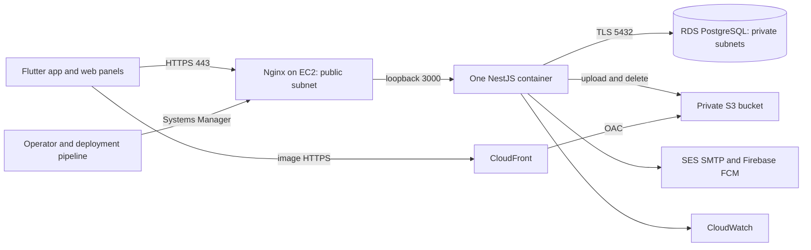

# Areana backend: AWS Free Tier EC2 and RDS deployment plan

Prepared: 16 November 2026. Revised for the user's Free Tier requirement and confirmation that the AWS account has not been created yet. Status: proposed deployment plan based on repository review; account creation, infrastructure and application changes below are still to be implemented.

## 1. Recommended launch setup

Start with one Dockerized NestJS process on a small EC2 instance, private Amazon RDS for PostgreSQL, S3 for venue images, and HTTPS on the API domain. Target the new-customer Free Plan and spend its credits carefully. Use local/CI PostgreSQL for routine staging checks and provision a temporary isolated AWS rehearsal only when needed. This is a low-traffic trial configuration with maintenance downtime and a single application host; section 11 is a later paid availability upgrade.

Planning assumptions, pending project-specific inputs:

| Decision | Initial choice |
| --- | --- |
| AWS Region | Use `ap-south-1` (Mumbai) as the planning placeholder. Confirm account service availability, costs, and measured latency from Pakistani users before provisioning. |
| Traffic | Low initial traffic; determine capacity using representative booking, search, and login load in staging. |
| API hostname | `api.<your-domain>`; use a separate staging hostname. |
| Compute | One EC2 `t3.micro`, Linux x86_64, 1 GiB RAM, CPU credit mode Standard. Build images in CI. If staging proves 1 GiB insufficient, `t3.small` (2 GiB) is also eligible under the new credit-based offer but consumes credits faster; estimate before selecting it. |
| Database | RDS PostgreSQL 16, supported minor offered in the Region, `db.t4g.micro` or `db.t3.micro`, Single-AZ, 20 GiB standard SSD using the console's Free tier preset. Compare gp2/gp3 pricing if both are offered. Disable storage autoscaling for the capped trial and alarm on free storage. |
| Operating system | Amazon Linux 2023 host; pinned Debian-based Node container with required OpenSSL and CA packages. |
| Ingress | Elastic IP, host Nginx, Let's Encrypt certificate with automatic renewal, Docker API published on `127.0.0.1:3000`. |
| Administration | AWS Systems Manager Session Manager; no inbound SSH needed. |
| Images | Private S3 bucket and CloudFront with Origin Access Control (OAC). |
| Email | Amazon SES SMTP on port 587 with STARTTLS, or an already configured production SMTP provider. |
| Secrets and artifacts | SSM Parameter Store Standard `SecureString` parameters with the AWS-managed key, where available in the plan; private ECR images tagged by Git commit and deployed by digest. Keep image retention small. |
| Observability | Basic EC2/RDS metrics, short-retention logs, a minimal set of alarms, and an external HTTPS check. Meter optional custom metrics and agents before enabling them. |

### New-account eligibility and signup

AWS's current new-customer offer provides $100 on signup and up to $100 more for completed activities. The Free Plan ends after six months or when credits are exhausted, whichever comes first; it does not provide unlimited EC2/RDS hosting. Record the exact plan and credit expiry shown in the account. The current signup experience differs from older 12-month tutorials. See [current Free Tier FAQ](https://aws.amazon.com/free/free-tier-faqs/) and [account-plan comparison](https://docs.aws.amazon.com/awsaccountbilling/latest/aboutv2/free-tier-plans.html).

1. Create the new AWS account and confirm **Free Plan**, available credits, and end date. Eligibility assumes this is the customer's first AWS account. Enable MFA and use the account's supported operator access method.
2. Use one Region. Confirm the selected EC2 AMI/type and RDS PostgreSQL **Free tier** preset are available without upgrading the account. Review the estimate and storage/backups before creation. See [EC2 offer](https://aws.amazon.com/free/compute/) and [RDS offer](https://aws.amazon.com/rds/free/).
3. Complete only useful credit-earning activities; verify credits actually appear. Avoid enabling features that upgrade the account to a paid plan simply to complete this deployment. Confirm IAM/SSM and optional service capabilities in the new account before choosing automation.
4. Track the cost/credit widget weekly, with alerts and reminders before the displayed expiry. Calculate runtime from **awarded credits divided by measured monthly usage**, capped by the plan end date; six months is a maximum, not a promise that this stack's credits will last that long.
5. Export database and image backups before expiry. To keep serving users, deliberately move to a paid plan before access ends. The Free Plan loses resource access when it expires. See [Free Tier terms](https://aws.amazon.com/free/terms/).

The older 750-hours/month and 12-month micro-instance rules are not the budget model for this new account. EC2, RDS, EBS, IPv4, storage, logs, and email usage can consume credits even when a console choice is labeled eligible. Avoid a permanently running second environment, NAT gateway, ALB, Multi-AZ, paid support, premium AMIs, and optional monitoring add-ons for this trial.

Do not deploy the local `docker-compose.yml` database or Mailpit as production dependencies. RDS replaces the local PostgreSQL container; a real SMTP service replaces Mailpit.



## 2. Repository work required before deployment

These findings come from the current code. Treat the launch gates as work items, not completed capabilities.

| Priority | Current state | Required change and completion evidence |
| --- | --- | --- |
| Launch gate | `Dockerfile` uses `npm ci`, but no lockfile is committed. | Commit a reviewed `package-lock.json`, use `npm ci` in CI, and prove a clean checkout builds. Pin matching `prisma` and `@prisma/client` versions. |
| Launch gate | No `prisma/migrations` directory exists. | Generate and review the initial SQL migration against a disposable database; commit the migration directory and lock file. Prove `prisma migrate deploy` creates the schema on an empty staging database. |
| Launch gate | Runtime omits dev dependencies but invokes `npx prisma migrate deploy`; Prisma CLI is a dev dependency. | Build a dedicated migration/tooling image target containing the pinned Prisma CLI and seed tooling. Execute migrations once per release; the application entrypoint only runs Node. No package downloads during container startup. |
| Launch gate | Docker uses `node:20-alpine`. | Replace the EOL runtime. Latest patched Node 22 is a conservative Prisma 6 compatibility bridge; pin the tested image digest. Schedule a tested Node/Prisma upgrade before Node 22 support ends on 30 April 2027. See [Node release schedule](https://github.com/nodejs/Release) and [Prisma 6 requirements](https://www.prisma.io/docs/guides/upgrade-prisma-orm/v6). |
| Launch gate | No `.dockerignore`; build stage copies the whole repository. | Exclude `.env` files, `.git`, local AWS credentials, uploads, dependencies, and generated output from the build context. Review the resulting image for embedded secrets. |
| Launch gate | Runtime runs as root with a shell startup command; Nest shutdown hooks are absent. | Use a non-root runtime, exec-form `node dist/main`, Nest shutdown hooks, and a termination grace period. Verify SIGTERM drains requests and disconnects Prisma. |
| Launch gate | `src/health/health.controller.ts` returns HTTP 200 even when its DB check fails. | Make `/api/health` return 200 only when ready and 503 on database failure, with a bounded query timeout. Add a separate process liveness endpoint. Verify both outage and recovery. |
| Launch gate | `src/storage/storage.service.ts` always passes explicit S3 credentials. | Omit explicit credentials for AWS and use the SDK default credential chain with the EC2 role. Preserve explicit credentials only for deliberately configured non-AWS storage. Verify image upload, read, and delete without long-lived AWS keys. |
| Launch gate | S3 image URLs assume objects can be read publicly. | Set `S3_PUBLIC_URL` to CloudFront and keep the bucket private. Test actual URLs returned by the API; also verify image deletion resolves the correct key. |
| Launch gate | Production settings can accept example JWT secrets and local mail/storage defaults. | Add production configuration checks: distinct strong JWT secrets, exact CORS origins, real SMTP, S3 settings, and valid FCM credentials if push is required. Fail startup on invalid required settings. |
| Launch gate | Booking overlap is checked before the insert transaction (`src/bookings/bookings.service.ts`); the schema uniquely constrains identical start times across all statuses, including cancelled bookings. | Prove concurrent overlapping multi-slot requests cannot both succeed. Replace the unconditional start-time uniqueness rule with active-status-aware protection that allows cancellation/rebooking. Protect ranges with a database constraint or a carefully designed transaction/locking strategy covering all booking/rescheduling paths. A single EC2 process still handles concurrent requests. |
| Launch hardening | OTP generation uses `Math.random`; staff login has no visible global request limiter; Swagger is always public. | Use cryptographic randomness for OTPs, add proxy/application rate limits for login and OTP endpoints, configure security headers and trusted proxy handling, and restrict or disable production Swagger. |
| Scaling gate | Every app process imports the cron scheduler. Jobs read records before sending notifications/updating state. | Keep one active scheduler at launch. Before replicas or overlapping deployments, add an explicit scheduler switch/worker, locking or atomic claims, and idempotency for notifications/rewards. Current status flags alone do not prevent races. |

Also retain `TZ=Asia/Karachi` in the actual application and tooling containers. Test timezone data in the selected image, midnight boundaries, date round trips through PostgreSQL, and the nightly 02:00 schedule. Do not assume changing the RDS server timezone fixes application date handling.

## 3. Network and access design

Create a dedicated VPC with DNS support and non-overlapping CIDRs. An illustrative layout is:

| Subnet | Example CIDR | Use and routing |
| --- | --- | --- |
| Public A | `10.20.0.0/24` | Launch EC2; internet route through the internet gateway. |
| Public B | `10.20.1.0/24` | Reserve for a future public ALB in a second AZ. |
| Private DB A | `10.20.10.0/24` | RDS subnet group, AZ A; no direct internet route. |
| Private DB B | `10.20.11.0/24` | RDS subnet group, AZ B; no direct internet route. |

RDS must have public accessibility disabled. Its subnet group spans two AZs even for this Single-AZ launch. Allow database access from the EC2 security group, using the private RDS endpoint. See [AWS RDS VPC guidance](https://docs.aws.amazon.com/AmazonRDS/latest/UserGuide/USER_VPC.WorkingWithRDSInstanceinaVPC.html).

| Security group | Inbound rules |
| --- | --- |
| `areana-prod-app` | TCP 443 from users; TCP 80 for redirect and HTTP certificate validation. No public 22, 3000, or 5432. |
| `areana-prod-db` | TCP 5432 from `areana-prod-app` only. Add a separate migration-runner group only if such a runner is introduced. |

The public application host uses one public IPv4/Elastic IP for outbound access to ECR, SSM/Parameter Store, SMTP, S3, and FCM; this launch layout needs no NAT gateway. The address can consume credits and is not inherently free. RDS does not need a NAT gateway for application connections. Account for outbound DNS and required service ports when restricting egress.

Install SSM Agent and attach a least-privilege instance profile. Require IMDSv2. For Docker access to role credentials, configure and test metadata response hop limit 2 as described in [EC2 metadata options](https://docs.aws.amazon.com/AWSEC2/latest/UserGuide/configuring-IMDS-new-instances.html). Session Manager requires appropriate IAM permissions and outbound connectivity; see [SSM instance permissions](https://docs.aws.amazon.com/systems-manager/latest/userguide/setup-instance-permissions.html).

Use account MFA and the plan's supported operator access. Scope the EC2 role to the required upload prefix, ECR pulls, named parameters, log groups, and SSM functions where those permissions are available. Scope deployment permissions to the production instance and approved commands. An EC2 instance role is shared host authority: ordinary Docker containers do not receive separate IAM roles. If the new account's access model blocks a required capability, resolve that before deployment rather than silently upgrading to paid features. A separate migration runner is a later option for stronger isolation.

## 4. RDS configuration and database lifecycle

1. Create the PostgreSQL instance in the private DB subnet group with encrypted storage, deletion protection, and an explicit supported engine minor. Place the initial primary in the application's AZ to avoid unnecessary cross-AZ traffic. Match staging to production's major version. Choose self-managed credentials for this trial rather than automatically adding Secrets Manager password management; protect the master credential separately. Leave paid performance/monitoring add-ons disabled unless explicitly budgeted.
2. Keep automated backups enabled, initially with 7-day retention for the trial; inspect the estimated backup storage cost. Choose a backup window outside busy hours and keep maintenance away from the app's nightly jobs. Disable storage autoscaling for the initial 20 GiB trial and alert before the volume fills; any future increase needs a new cost estimate and will not automatically reverse.
3. Create separate `areana_app` and `areana_migrator` users. The runtime user receives only the application schema/table/sequence privileges it needs; the migration user owns/manages schema objects. Set default privileges for objects created by future migrations. Keep the RDS master credential out of the application.
4. Set and verify `rds.force_ssl=1`. Include the current AWS RDS CA bundle in both app and migration containers, and track CA expiration/rotation.
5. Start with `connection_limit=3` per application process, then size it using measured load and the micro database's memory/connection headroom. Count migration/admin connections. Avoid RDS Proxy and extra workers in the initial trial; add them only if measurements and a revised budget justify them.
6. Verify runtime CRUD succeeds and runtime DDL fails. Verify migration DDL succeeds. Confirm a wrong CA fails to connect and that the real connection uses TLS.

Proposed Prisma 6 runtime URL, stored as a secret; all placeholders must be replaced and user/password values URL-encoded:

```text
postgresql://areana_app:<URL_ENCODED_PASSWORD>@<RDS_ENDPOINT>:5432/areana?schema=public&sslmode=require&sslaccept=strict&sslcert=/app/certs/global-bundle.pem&connection_limit=3
```

Prisma's built-in connector has its own supported URL options. Use `sslmode=require`, a trusted CA, and strict certificate checks; test these with the exact pinned Prisma version. Use the real RDS hostname. See [Prisma 6 PostgreSQL TLS options](https://www.prisma.io/docs/orm/v6/overview/databases/postgresql) and [RDS PostgreSQL TLS](https://docs.aws.amazon.com/AmazonRDS/latest/UserGuide/PostgreSQL.Concepts.General.SSL.html). For `psql`/`pg_dump`, use their corresponding `sslmode=verify-full` and `sslrootcert` settings.

Choose the data path explicitly:

| Situation | Procedure |
| --- | --- |
| Empty production database | Run committed migrations, then controlled one-time seed/bootstrap. |
| Existing database with valuable data | Inventory its schema, data, extensions, and migration history. Take and rehearse an encrypted `pg_dump`/`pg_restore` into staging. If the source lacks migration history, establish and verify a Prisma baseline instead of applying a create-all migration over existing tables. |
| Final migration/cutover | Pause writes and schedulers on the old system, take the final dump or complete the chosen replication cutover, restore/validate, reconcile migration history, then enable only the new writer. Larger datasets or tighter downtime requirements need a separate replication/DMS plan. |

Bootstrap must deliberately supply `ADMIN_EMAIL` and a strong `ADMIN_PASSWORD`. The seed also creates essential roles, settings, and badges. Run it once using the tooling image. Its role upserts overwrite permissions, and its existing-admin update is empty: rerunning it does not rotate an existing admin password. Remove bootstrap credentials from normal runtime configuration afterward.

## 5. Production configuration and external services

Use SSM Parameter Store Standard `SecureString` values with the AWS-managed key for small secrets where available in the account plan. Standard parameter storage avoids the per-secret Secrets Manager fee; check KMS/API usage separately. Each standard value is limited to 4 KiB, so verify the Firebase JSON size and use a separately protected file if necessary rather than silently enabling the advanced tier. See [Parameter Store tiers](https://docs.aws.amazon.com/systems-manager/latest/userguide/systems-manager-parameter-store.html) and [Systems Manager pricing](https://aws.amazon.com/systems-manager/pricing/).

Deliver only needed values to the container at launch; avoid printing them in CI, shell traces, SSM command parameters, or logs. If a generated env file is used, place it outside the repository with restricted permissions, preferably on tmpfs, and handle JSON/newlines without shell evaluation. Rotate secrets through a deliberate update and container restart; environment variables do not refresh themselves. If managed parameter access is unavailable in the Free Plan, a manually delivered, root-owned configuration file outside Git on encrypted EBS is the initial fallback.

| Variable | Production value or policy |
| --- | --- |
| `NODE_ENV`, `PORT`, `TZ` | `production`, `3000`, `Asia/Karachi`. |
| `CORS_ORIGIN` | Exact HTTPS origins for owner/admin web panels, comma-separated. Native Flutter clients do not need a browser CORS origin. |
| `DATABASE_URL` | Runtime DB user and verified RDS TLS connection from section 4. Use a separate URL for migration jobs. |
| `JWT_ACCESS_SECRET`, `JWT_REFRESH_SECRET` | Separate secrets generated from at least 32 random bytes each. Keep stable across releases and replicas; plan rotation because replacing them invalidates tokens. |
| `JWT_ACCESS_TTL`, `JWT_REFRESH_TTL` | Start with current 900 / 604800 seconds unless product requirements change. |
| `SMTP_HOST`, `SMTP_PORT`, `SMTP_USER`, `SMTP_PASS`, `MAIL_FROM` | Real provider endpoint, port 587, provider SMTP credentials, verified sender. Require STARTTLS in the mail transport. |
| `STORAGE_DRIVER`, `S3_BUCKET`, `S3_REGION`, `S3_PUBLIC_URL` | `s3`, production upload bucket, chosen Region, `https://<cloudfront-domain>` or image domain. |
| `S3_ENDPOINT`, `S3_ACCESS_KEY`, `S3_SECRET_KEY` | Omit for normal AWS S3 after the instance-role code change. Do not inject empty explicit credential objects. |
| `FCM_ENABLED`, `FCM_SERVICE_ACCOUNT` | Enable only with validated Firebase credentials and a successful real-device test. Preserve the service-account JSON correctly. If push is a launch requirement, initialization failure must fail validation/raise an alert instead of silently accepting log-only mode. |
| `ADMIN_EMAIL`, `ADMIN_PASSWORD` | Bootstrap tooling only; absent from the ordinary API container. |

For image delivery, enable S3 Block Public Access, encryption, versioning, and a lifecycle policy for old versions. Give EC2 upload/delete access only to `venues/*`. Give CloudFront read access through an OAC bucket policy restricted to its distribution. Use a regular S3 origin, and make viewer requests HTTPS. The default CloudFront domain avoids a separate image certificate initially. See [CloudFront OAC setup](https://docs.aws.amazon.com/AmazonCloudFront/latest/DeveloperGuide/private-content-restricting-access-to-s3.html).

For email, verify the sending domain and configure DKIM, SPF/custom MAIL FROM as needed, and DMARC. Request SES production sending access in the selected SES Region early; sandbox accounts cannot send OTPs to arbitrary users. Confirm quotas, delivery, bounces, and complaints. SMTP credentials differ from ordinary AWS access keys. See [SES production access](https://docs.aws.amazon.com/ses/latest/dg/request-production-access.html) and [SES SMTP TLS](https://docs.aws.amazon.com/ses/latest/dg/smtp-connect.html).

## 6. EC2, HTTPS, and release packaging

Provision one encrypted 20 GiB gp3 EBS volume, an instance role, SSM, host security updates, Docker/Compose, Nginx, and certificate automation. Use the minimum available monitoring setup first; add the CloudWatch agent/custom metrics only after checking their credit cost. Record configuration in version-controlled infrastructure as code where account capabilities allow; Terraform is a reasonable choice, with encrypted protected state. Keep state out of Git because it can contain secrets.

The micro host has only 1 GiB RAM. Build and run the full test suite off-host. Limit log/image accumulation and verify peak memory while the tooling container runs. A small encrypted-EBS-backed swap file can reduce sudden OOM failures but is not a substitute for adequate capacity. If the real workload fails on micro, re-estimate `t3.small` rather than promising a viable deployment at 1 GiB.

Create a production Compose definition containing the application only. Publish its port on loopback, set restart policy and log rotation, and ensure it starts on host reboot. Use a systemd deployment/service wrapper where necessary. Keep Nginx/certificate configuration reproducible and persist certificate renewal state outside the application container.

Nginx should forward `/api` unchanged, supply trusted forwarding headers, redirect HTTP to HTTPS, apply appropriate request timeouts and login/OTP limits, and allow multipart images slightly above the application's 5 MiB file limit. Configure trusted proxy handling explicitly before applying client-IP limits. Validate certificate renewal and alert before expiry. Manage images and logs so the disk cannot fill.

The Docker build should produce two tested targets from the same commit:

- **Application:** compiled `dist`, production dependencies, generated Prisma engine/client, CA bundle, non-root user, and exec-form Node entrypoint. Match native dependencies such as bcrypt/Prisma to the target OS and CPU.
- **Migration/bootstrap tooling:** committed schema/migrations, matching Prisma CLI, seed source and its required tooling, plus the same CA bundle. Supply the privileged DB credential only to this task.

Build for `linux/amd64` for the proposed EC2 host, including when developing on Apple Silicon. Keep the host OS architecture independent of the managed RDS instance architecture. Store immutable image digests and the previous successful release manifest in ECR/deployment records.

## 7. Deployment workflow

Use this sequence manually for the first temporary AWS rehearsal, then automate the same steps only when the Free Plan supports the needed permissions. If the repository is on GitHub, use Actions within its own included usage allowance; AWS credits do not cover GitHub charges. AWS OIDC with narrowly scoped repository/environment trust is the later automation choice where available, rather than stored AWS access keys. See [GitHub AWS OIDC guidance](https://docs.github.com/en/actions/how-tos/secure-your-work/security-harden-deployments/oidc-in-aws).

1. **Build and verify in CI:** clean `npm ci`, Prisma generate/validate, TypeScript build, dependency/image checks, and integration tests against disposable PostgreSQL 16. Build and push app/tooling targets once; promote the same digests from staging to production.
2. **Serialize deployment:** allow one production release/migration at a time. Record release SHA, image digests, schema migration, previous version, and operator.
3. **Preflight:** verify a recent recoverable backup, credentials, disk/memory, RDS reachability, pending migration SQL, and rollback compatibility. Take a manual snapshot before schema changes that warrant it.
4. **Enter the launch maintenance window:** have Nginx serve an explicit temporary 503 with `Retry-After`; stop the old application and its scheduler, allowing active requests to drain. This prevents concurrent jobs and incompatible writes during migration.
5. **Migrate inside the VPC:** the reviewed SSM deployment script runs a one-off tooling container on the EC2 host, invoking its pinned `npm run prisma:deploy` using the migration URL. CI's public runner must not require opening RDS to the internet. Ensure the deploy execution can securely obtain its required secrets; keep the master credential out of the task. Any failed migration stops the release.
6. **Bootstrap only when required:** run `npm run db:seed` in the tooling target for the initial setup. Routine releases skip this step. Never use `migrate dev`, `migrate reset`, or `db push` against production.
7. **Start the new app:** inject production settings and launch exactly one process/container. Check local readiness with the full response, not just a successful HTTP request.
8. **Restore traffic:** remove the maintenance response after readiness and required checks pass. Verify HTTPS health through the public hostname, authentication, and a controlled business operation; watch logs and alarms for at least 15–30 minutes.
9. **Record success:** retain the previous deployable image/configuration and migration outcome. Re-enable paused schedules exactly once and confirm job execution.

Use SSM for management and deployment transport; review the production deploy script as privileged code. Keep permissions and secret delivery scoped. An initial lean host role may need both runtime and deployment secret access, which shares trust with containers that can use that role; use a separate in-VPC migration runner if stricter separation is required. Schema-changing automation is ready only when that secret path and migration recovery are tested.

Routine releases in this design have a maintenance interval. Do not promise zero downtime until the scheduler coordination, schema compatibility, load balancer, and multiple-instance design are implemented.

## 8. Staging and launch acceptance

Run routine staging checks on local/CI PostgreSQL and Mailpit. For the AWS-specific rehearsal, use an isolated temporary database/environment with separate credentials and test data. Use the one RDS instance first as a disposable rehearsal target, then recreate a clean launch database before real data is accepted, or budget a brief second instance. Do not share a live database with the mutating smoke tests. The existing `scripts/smoke-test.mjs` creates users, venues, and bookings and reads OTPs from Mailpit; adapt separate controlled checks for production SMTP and live data. Remove temporary resources and unneeded retained snapshots after the rehearsal; stopping compute does not eliminate storage costs.

Required acceptance checks:

- Clean build from committed files; empty-database migration; one-time seed; restart and host reboot recovery.
- `/api/health` returns 200 while ready and 503 during a simulated DB outage; liveness remains independent; readiness recovers afterward.
- HTTPS certificate, HTTP redirect, production CORS origins, rate limits, restricted Swagger, and blocked external 22/3000/5432 access.
- Verified database TLS and rejected invalid CA; app user lacks schema-changing rights; migrations use the intended privileged user.
- Real OTP delivery and verification, owner approval/login, token refresh, and permission boundaries.
- Venue image upload, returned CloudFront URL, delete, and retention after app/container replacement.
- Search and booking create/accept/cancel/reschedule; parallel identical-start and overlapping different-start multi-slot requests; cancellation/rebooking; midnight/timezone boundaries.
- Exactly one execution of each scheduled job; no duplicate reminders/rewards after restart. Test long-running jobs and recovery from downtime.
- Real-device push notification if enabled; alert on FCM initialization/delivery failures.
- Representative load with agreed concurrency, latency, and error-rate targets; record memory, CPU credits, Prisma pool pressure, DB CPU/connections, and slow queries.
- Successful application rollback and a separate RDS restore rehearsal, with measured recovery times.

Production is ready when all launch gates and acceptance checks have evidence, monitoring reaches the responsible operator, the domain and SMTP provider work, and rollback/restore procedures have been rehearsed.

## 9. Monitoring, backups, and recovery

Use rotated local logs and a small CloudWatch log volume where available, initially with 3–7 day retention. Log request IDs, route, status, latency, and safe error context; redact tokens, passwords, OTPs, service-account material, and database URLs. Record scheduler start/success/failure/last-run events so a stopped job is detectable. Add paid custom metrics only after estimating them.

Suggested initial alarms, to tune after staging measurements:

| Signal | Initial response |
| --- | --- |
| HTTPS readiness fails for consecutive probes | Notify the operator; inspect app, DB, and deployment state. |
| EC2 status check failure or container crash loop | Notify and recover/recreate the host from recorded infrastructure. |
| Sustained CPU above 70%, RAM above 80%, or disk free below 20% | Inspect load/leaks/disk usage; resize or optimize. Check memory/disk locally with host tools, or use the CloudWatch agent to publish them as metered custom metrics. |
| Low CPU credit balance or surplus credit charges | Reassess burstable instance sizing/mode and sustained workload. |
| Elevated 5xx/latency or DB connection use above 70% of the chosen budget | Investigate queries, pool settings, dependencies, and application errors. |
| RDS low free storage/memory, failed backups, or abnormal DB load | Investigate, scale, and confirm recoverability. |
| Scheduler missed its expected run, SMTP failures, or required FCM failure | Alert on the affected business function even if HTTP health remains green. |
| Monthly forecast exceeds agreed budget | Investigate storage, traffic, CPU credits, logs, and unused resources. |

Proposed recovery targets to validate, not guarantees: application rollback within 15 minutes; database recovery within 60 minutes on the initial dataset; data loss limited to the latest available restore point, with a target of no more than 15 minutes. Inspect RDS `LatestRestorableTime` and measure a restore before accepting these targets.

For an application regression with compatible schema, return to the previous digest and matching configuration, verify readiness, then restore traffic. Keep migrations backward-compatible using additive changes, backfills, and later cleanup. A failed migration needs inspection and a reviewed forward fix/Prisma recovery procedure; do not blindly rerun/reset it.

For data loss or an incompatible schema incident, stop writes and jobs, choose the recovery point, restore to a **new** RDS instance, reapply/verify its private networking, parameter groups and users, validate data, update the DB secret/endpoint, and restart the matching app version. Reconcile any legitimate writes after the recovery point before reopening service. RDS point-in-time restore does not replace the old instance in place. See [RDS restore procedure](https://docs.aws.amazon.com/AmazonRDS/latest/UserGuide/USER_PIT.html).

Perform a restore rehearsal before launch and periodically afterward. RDS backups and S3 versioning cover different data; test both. Multi-AZ addresses availability and does not replace backups or a regional disaster-recovery plan.

## 10. Costs and work sequence

Create and save a Region-specific [AWS Pricing Calculator estimate](https://calculator.aws/) before provisioning, then compare metered usage with the **actual credited balance** in the account. For this new signup, zero out-of-pocket Free Plan usage is possible while eligible credits and plan access remain; the stack still has a metered monthly cost. Do not assume old 750-hour/12-month allowances or that the full $200 has already been awarded.

| Cost item | Quantity to enter for the lean launch |
| --- | --- |
| EC2 | One Linux `t3.micro`, approximately 730 hours/month, Standard CPU credits. Estimate `t3.small` only if memory tests require it. |
| EC2 storage | One 20 GiB gp3 volume; count any swap within it and separately retained snapshots. |
| RDS | One PostgreSQL `db.t4g.micro` or `db.t3.micro` Single-AZ, approximately 730 hours/month, 20 GiB SSD, backup/snapshot storage and any burst CPU charges. Autoscaling disabled for the trial. |
| Network | One Elastic IP/public IPv4, internet data transfer, and any cross-AZ traffic. |
| Image delivery | S3 stored bytes/requests and version history; CloudFront delivery/requests. |
| Operations | Minimal ECR storage, Standard Parameter Store/KMS/API use, short-retention logs and minimal alarms, DNS/domain, SMTP volume, and only temporary AWS staging resources. A domain purchase or an external provider's fees may require a separate budget. |
| Availability upgrade | ALB hours/capacity, second EC2, RDS Multi-AZ, and required NAT/endpoints. |

For scale: one public IPv4 at AWS's published $0.005/hour is about $3.65 for 730 hours before applicable credits/offers. Other rates depend on the selected Region and usage. See [VPC pricing](https://aws.amazon.com/vpc/pricing/), [EC2 pricing](https://aws.amazon.com/ec2/pricing/on-demand/), and [RDS PostgreSQL pricing](https://aws.amazon.com/rds/postgresql/pricing/). Track actual burn weekly, set credit/billing notifications and a small cost budget where supported, and plan exit reminders at least 30 and 7 days before account expiry. Budget alerts do not stop resources or guarantee a zero bill on a paid plan.

Select EC2 Standard credit mode to avoid surplus CPU charges, accepting throttling if credits run low. Burstable RDS can still consume surplus CPU charges/credits, so monitor it. Keep image/log/snapshot retention bounded. Export data and delete resources if the project ends; if the app must remain online, deliberately fund and upgrade the account before the Free Plan ends.

Suggested execution order; effort estimates depend on the application fixes and data volume:

| Phase | Work | Exit condition |
| --- | --- | --- |
| 1 — account and decisions | Create the account, confirm Free Plan/credits/end date and service/permission availability, enable MFA, choose Region and domain, confirm SMTP/Firebase access. Start sender verification. | Recorded eligibility, expiry, awarded credit balance, and usage estimate. |
| 2 — application preparation | Lockfile, migrations, Docker targets, readiness, IAM-backed storage, production validation, concurrency/job/security fixes. | Clean reproducible build and meaningful integration checks. |
| 3 — temporary AWS rehearsal | VPC, security groups, one micro RDS and EC2/SSM, ECR, protected configuration, S3/CloudFront, HTTPS and minimal monitoring. | Rehearsal reachable through HTTPS with private DB access and verified credit burn. |
| 4 — rehearsal | Full business flow, load and outage tests, migration/import rehearsal, rollback, restore, alarms and runbooks. | Evidence for section 8 and measured recovery targets. |
| 5 — launch | Replace rehearsal data with a clean launch database, migrate, bootstrap, deploy, and cut over DNS/clients. Keep test data and credentials separate. | Public health, real email/image/push checks, recovery evidence and operator acceptance. |
| 6 — stabilization | Observe the first nightly job and 24–48 hours of traffic, then tune resources and alarms. | Stable jobs, resource usage, errors and spend. |

Allow several engineering days for preparation and staging, plus sender/DNS approval lead time. Estimate the production maintenance window from the actual migration/import rehearsal rather than guessing.

## 11. Upgrade to high availability

This is a later paid upgrade. If bookings must remain available through an instance or AZ failure, budget and make these changes before that launch:

1. Put a public ALB in two public subnets, with an ACM certificate in the ALB Region; redirect port 80 to 443. Register targets with the corrected readiness path. See [ALB HTTPS certificates](https://docs.aws.amazon.com/elasticloadbalancing/latest/application/https-listener-certificates.html).
2. Run at least two EC2 app instances in private application subnets across AZs, using an Auto Scaling Group. Allow their app port only from the ALB security group. Remove direct public app ingress and host certificate management.
3. Provide outbound paths for ECR/secrets/SSM and for external SMTP/FCM. Budget NAT gateways or an appropriate endpoint/egress design; private subnet placement alone does not provide outbound connectivity.
4. Enable RDS Multi-AZ and rehearse failover/reconnection. Increase capacity based on connection and load measurements.
5. Separate scheduled work from API replicas. Add atomic ownership, distributed locking, and durable notification/reward idempotency. Ensure scheduler leadership has its own recovery path.
6. Use backward-compatible migrations and rolling deployments with target draining. Test that two instances cannot double-book, duplicate jobs, or use inconsistent JWT secrets/configuration.

Suggested future repository deliverables: `infra/` for infrastructure code, `.dockerignore`, revised multi-target `Dockerfile`, `docker-compose.prod.yml`, reviewed deployment/rollback scripts, CI configuration, and versioned Prisma migrations. This plan documents their scope; they have not been created by this planning task.
